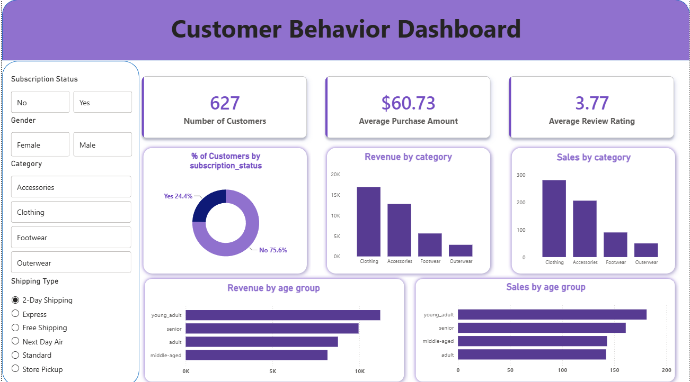

# Customer Shopping Behavior — Data Analytics Portfolio Project

An end-to-end analytics pipeline built around a customer shopping behavior dataset — from raw data cleaning in Python, through storage in SQL Server, to an interactive Power BI dashboard.

## Goal

Build a complete, presentable analytics pipeline: clean and structure raw shopping data, move it into a relational database, and surface key customer and sales insights through an interactive dashboard.

## Tech Stack

- **Python** (pandas, Jupyter Notebook) — data cleaning and transformation
- **SQL Server** (SSMS) — relational storage and querying
- **SQLAlchemy + pyodbc** — Python-to-SQL Server connectivity
- **Power BI Desktop** — interactive dashboard and visualization

## Repo Structure

```
Customer Shopping Behavior Analysis/
├── powerbi/
│   └── Customers Analysis Dashboard.pbix
├── python/
│   └── customer_behavior_analysis.ipynb
├── reports/
│   ├── Customer_Shopping_Behavior_Report.docx
│   └── screenshots/
│       └── dashboard.png
├── sql/
│   └── customer_behavior_analysis.sql
└── README.md
```

## Repo Contents

| File | Description |
|---|---|
| `python/customer_behavior_analysis.ipynb` | Data cleaning, standardization, and feature engineering in pandas |
| `sql/customer_behavior_analysis.sql` | SQL queries: exploration, revenue/spending, customer loyalty, window functions, CTEs & subqueries, discounts/shipping/payment |
| `powerbi/Customers Analysis Dashboard.pbix` | Power BI dashboard (Customer Behavior Dashboard) |
| `reports/Customer_Shopping_Behavior_Report.docx` | Full write-up of the project, methodology, and findings |
| `reports/screenshots/` | Dashboard screenshots referenced below |

## Data Preparation

- Loaded the raw CSV and reviewed structure via `df.info()`, `df.describe()`, and null counts
- Filled missing `review_rating` values using the median rating within each product category
- Standardized column names to lowercase with underscores
- Engineered `age_group` (young_adult, adult, middle-aged, senior) via `pd.qcut`
- Converted `frequency_of_purchases` into a numeric `purchase_frequency_days` field
- Dropped `promo_code_used` (fully redundant with `discount_applied`)
- Loaded the cleaned dataframe into SQL Server via SQLAlchemy/pyodbc

## SQL Analysis

Queries in `sql/customer_behavior_analysis.sql` cover:
- Basic exploration and category breakdowns
- Revenue and spending by category, age group, gender, and subscription status
- Customer loyalty (purchase frequency, most loyal customers)
- Window functions: `RANK()`, running totals, `PERCENT_RANK()`, `LAG()`
- CTEs and subqueries for above-average spenders/categories and below-average ratings
- Discount, shipping, and payment method breakdowns

## Power BI Dashboard



A single-page "Customer Behavior Dashboard" featuring:
- KPI cards: number of customers, average purchase amount, average review rating
- Donut chart of subscription status
- Revenue and sales by category and age group
- Slicers for subscription status, gender, category, and shipping type, all cross-filtering together

## Key Observations

- Clothing and Accessories drive noticeably more revenue and sales volume than Footwear and Outerwear
- Only ~24% of customers are on an active subscription — a potential retention opportunity
- Revenue and sales are fairly evenly spread across age groups
- Average review rating (3.77/5) is moderate and could be worth segmenting further by category

## Setup Notes

The SQL Server connection string uses a placeholder server name. Set your own via an environment variable before running the notebook:

```
SQL_SERVER_NAME=YOUR_MACHINE\SQLEXPRESS
```

or edit the default directly in the connection cell.

If a `.ipynb_checkpoints/` folder ends up in the repo, it's safe to delete and add to `.gitignore` — it's just an auto-saved Jupyter backup, not part of the project.
